# Database

PostgreSQL on Supabase, defined entirely by migrations in `supabase/migrations/`. No undocumented manual setup.

| Migration | Contents |
|---|---|
| `…0001_foundation.sql` | extensions (pgcrypto, vector), `profiles` + auth trigger, `organizations`, `organization_members`, `invitations`, `organization_constitutions`, RLS helper functions, `create_organization()` and `accept_invitation()` RPCs |
| `…0002_csuite.sql` | executives (+ personas, skills, model configs, voices), `prompt_templates`, `human_ceo_intelligence`, `projects`, `conversations`, `messages`, `communications`, `executive_sessions` (+ messages, votes), `decisions` |
| `…0003_intelligence.sql` | `memory_records` (pgvector + tsvector), `match_memory_records()`, `files`, `reports`, `production_jobs`, `production_artifacts`, `approval_requests`, `notifications`, `ai_usage_records`, `provider_credentials`, `audit_logs` |
| `…0004_rls.sql` | RLS on every tenant table, privacy overrides (private conversations, participant-only comms, memory visibility, owner-only CEO intelligence, write-only credentials, append-only audit), private storage bucket and policies |

Apply locally: `supabase start && supabase db reset`. Production: `supabase db push`.

## ERD

```mermaid
erDiagram
  profiles ||--o{ organization_members : "belongs to"
  organizations ||--o{ organization_members : has
  organizations ||--|| organization_constitutions : has
  organizations ||--o{ invitations : issues
  organizations ||--o{ ai_executives : employs
  ai_executives ||--|| ai_executive_personas : has
  ai_executives ||--|| ai_executive_model_configs : has
  ai_executives ||--o{ ai_executive_skills : has
  ai_executives ||--o| ai_executive_voices : has
  organizations ||--o{ prompt_templates : overrides
  organizations ||--o{ human_ceo_intelligence : "CEO profile"
  organizations ||--o{ projects : runs
  ai_executives ||--o{ conversations : "one-on-one"
  profiles ||--o{ conversations : owns
  conversations ||--o{ messages : contains
  organizations ||--o{ communications : "Executive Comms"
  organizations ||--o{ executive_sessions : convenes
  executive_sessions ||--o{ executive_session_messages : transcript
  executive_sessions ||--o{ executive_session_votes : votes
  executive_sessions ||--o{ decisions : produces
  projects ||--o{ decisions : scopes
  organizations ||--o{ memory_records : remembers
  projects ||--o{ memory_records : scopes
  organizations ||--o{ files : stores
  organizations ||--o{ reports : publishes
  ai_executives ||--o{ reports : leads
  organizations ||--o{ production_jobs : "Studio"
  production_jobs ||--o{ production_artifacts : versions
  ai_executives ||--o{ approval_requests : proposes
  profiles ||--o{ notifications : receives
  organizations ||--o{ ai_usage_records : meters
  organizations ||--o{ provider_credentials : configures
  organizations ||--o{ audit_logs : records
```

## Conventions
- UUID primary keys (`gen_random_uuid()`); `organization_id uuid not null` on every tenant table, `on delete cascade` from `organizations`.
- Status/enum columns use `text` + `check` constraints (easy to extend, readable in RLS).
- Timestamps `timestamptz default now()`.
- Full-text: generated `search_document tsvector` + GIN on communications, memory, reports.
- Vectors: `memory_records.embedding vector(256)` (lexical v1, written by the app) and `semantic_embedding vector(1536)` (provider embeddings, HNSW cosine index, written by the embedding worker).

## RLS model
- `is_org_member(org)`, `has_org_role(org, roles[])`, `can_write(org)`, `can_admin(org)` — `SECURITY DEFINER`, `search_path` pinned.
- Default: members read; OWNER/ADMIN/EXECUTIVE/MEMBER write; deletes restricted to operators.
- Exceptions: conversations/messages are private to their user; communications visible to sender/recipients only; memory honours `visibility`; CEO intelligence is owner-only; credentials have **no** client SELECT; audit is append-only, admin-readable; notifications recipient-only.
- Invitation acceptance runs through `accept_invitation()` with the service role after server verification; it can only create membership in the invitation's own organization.

## Isolation review checklist (run for every new table)
1. `organization_id` present and indexed (or ownership inherited via a parent FK + policy join).
2. `enable row level security` + select/insert/update/delete policies.
3. Server code reaches it only through `db()` with `orgId` from `requireContext()`.
4. Unit test proving cross-org reads/updates/deletes fail (`tests/unit/tenant-isolation.test.ts`).
